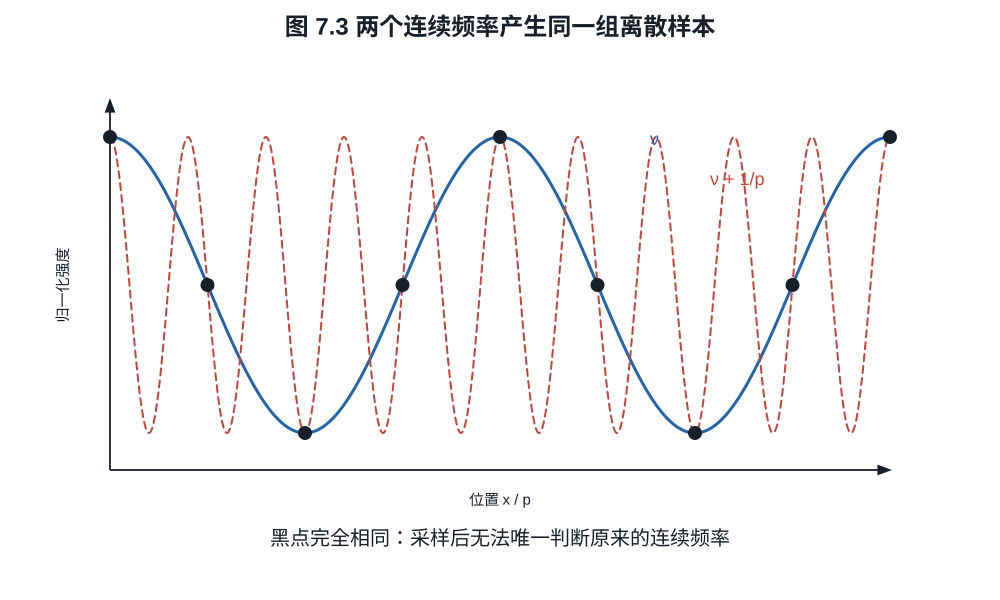

# 第七章：色彩滤阵、采样、去马赛克与色彩矩阵

一块灰布在日光下拍起来接近中性，移到暖灯下，未经白平衡的 RAW 往往红通道较强、
蓝通道较弱。把蓝通道提亮可以恢复中性外观，也会让它的噪声更显眼。若布料上还有
细条纹，照片中又可能出现原物没有的彩色波纹。这两个现象分别涉及像素对光谱的
加权和不同颜色样本的空间排列，处理时需要两套相互配合的模型。

## 7.1 相机通道是光谱积分

设落到像点的光谱曝光为 $H_\lambda(\lambda)$，第 $k$ 类滤色单元的总光谱响应为
$s_k(\lambda)$，则其平均电子数可抽象为

$$
c_k=\int_0^\infty H_\lambda(\lambda)s_k(\lambda)\,d\lambda. \tag{7.1}
$$

$s_k$ 包含像素面积、光子能量换算、滤色片与收集效率；本节的 $H_\lambda$ 已是
到达像面参考面的光谱曝光，所以镜头透射不再重复乘入。若从镜头前的场景光谱算起，
才需额外加入镜头的光谱透射。以下把波长限制在工作区间
$\Lambda=[\lambda_\min,\lambda_\max]$，其中 $0<\lambda_\min<\lambda_\max<\infty$，响应函数
取为有界可测实函数，光谱曝光为非负可积函数；区间外的响应设为零。

**命题 7.1（相机同色异谱的存在）.** 对任意三个线性独立响应函数
$s_R,s_G,s_B$，存在非零光谱扰动 $q(\lambda)$，使

$$
\int q(\lambda)s_k(\lambda)\,d\lambda=0,
\qquad k\in\{R,G,B\}.
$$

**证明.** 在有界波长区间内取四个线性独立、有界且紧支的函数，其张成空间记为
$V$，则 $\dim V=4$。线性映射

$$
T:V\longrightarrow\mathbb R^3,\qquad
T(q)=(\langle q,s_R\rangle,\langle q,s_G\rangle,\langle q,s_B\rangle)
$$

的秩至多为 $3$。秩--零化度定理给出 $\dim\ker T\ge1$，故存在有界紧支的
$q\ne0$ 使三个积分均为零。设 $K$ 包含 $q$ 的支集，取
$H_0=M\mathbf1_K$，其中 $M>\varepsilon\lVert q\rVert_\infty$。则
$H_0$ 与 $H_0+\varepsilon q$ 是两个不同的非负光谱，且它们的三个相机通道积分
相同。$\square$

这证明相机 RGB 不能唯一决定光谱。两条相机同色异谱的光谱在人眼下是否仍相同，还
取决于相机响应与人眼配色函数的关系；仅凭“只有三个通道”并不能判定色度转换一定
有误差。第 7.5 节会给出精确转换成立的条件。


*图 7.1　通道曲线是机制示意，并非某一传感器的标定数据。每个 RAW 通道是入射
光谱与相应响应函数的积分。有限个积分会保留光谱歧义；曲线是否重叠本身不决定
能否准确匹配人眼色度。*

## 7.2 Bayer 阵列与空间采样

常见 Bayer 单元为

```text
R G
G B
```

绿色采样密度较高，与人类亮度感知和常见自然光谱的工程权衡有关。每个位置仍只测
一个通道。若像素节距为 $p$，完整感光格的一维采样频率为 $1/p$，Nyquist 频率为
$1/(2p)$；但红、蓝各自沿行列每隔 $2p$ 才有一个样本，一维轴向 Nyquist 只有
$1/(4p)$。两个绿色位置合起来形成交错格点，频率支持随方向变化，不能用一个较小
的方形像素格替代。灰色纹理中三个通道常有相关结构，算法可借此估计较高频的亮度
细节；彩色细纹则可能破坏这项假设，形成伪色。


*图 7.2　每个格子只保存一个滤色通道的样本。去马赛克后的每像素 RGB 是邻域估计，
不能把输出 RGB 像素数直接解释为每通道独立测量数。*

采样前连续像首先经过镜头 PSF、像素孔径积分和可能的光学低通滤镜（OLPF）。用
$I(x,y)$ 表示连续像、$a(x,y)$ 表示像素孔径，理想采样为

$$
y[m,n]=\iint I(x,y)a(x-mp,y-np)\,dx\,dy.                 \tag{7.2}
$$

像素不是几何点，而是对面积积分；其矩形孔径 MTF 含 sinc 因子。微透镜与电荷扩散
会进一步改变有效孔径。

## 7.3 去马赛克不是“恢复原值”

去马赛克（demosaicing）根据邻域样本估计每个位置缺失的两个通道。最简单的双线性
方法在红像素位置用周围绿色平均估计绿，用对角蓝平均估计蓝。例如

$$
\widehat G_{m,n}
=\frac14(G_{m-1,n}+G_{m+1,n}+G_{m,n-1}+G_{m,n+1}).        \tag{7.3}
$$

若局部颜色平滑，式 (7.3) 可用；若穿过高对比边缘，它会跨边缘混合，产生彩边和
拉链伪影。现代算法会估计边缘方向、通道相关性或利用学习先验，但没有算法能从发生
混叠的单个样本唯一恢复所有可能原图。

**例子 7.2（超过 Nyquist 的条纹）.** 一维正弦
$I(x)=1+\cos(2\pi\nu x)$ 在点 $x=np$ 采样。对任意整数 $k$，频率
$\nu'=\nu+k/p$ 给出

$$
\cos(2\pi\nu'np)
=\cos(2\pi\nu np+2\pi kn)
=\cos(2\pi\nu np).
$$

所以多个连续频率产生完全相同样本。摩尔纹不是“分辨率不够导致模糊”，而是高频被
错误折回低频。OLPF 通过采样前衰减高频降低混叠，代价是原始锐度下降。



*图 7.3　采样点相同意味着仅由样本无法判定原连续频率。锐化不能区分真实高频与
已折叠的伪低频；防混叠必须发生在采样前或依靠额外观测。*

## 7.4 白平衡放大了什么

在某照明下，中性物体可能产生相机 RAW 均值

$$
(R,G,B)=(0.45,1.00,0.30).
$$

若以绿色为基准，白平衡增益为

$$
(w_R,w_G,w_B)=(2.22,1,3.33).
$$

乘法使中性物体变为 $(1,1,1)$，同时把蓝通道信号噪声标准差也乘 $3.33$。白平衡
不改变单个未剪切通道的 SNR，因为均值和标准差同乘一个数；但显示为中性后，原本
较弱的蓝通道对画面噪声的贡献更明显。以蓝通道 100 个电子、总噪声 12 个电子为例，
乘三后是 300 与 36，SNR 仍为 8.33。若白平衡之后又把通道裁切到有限范围，高光
信息还可能丢失。因此显影中通常保留浮点中间值，把显示裁切留到后续处理。

## 7.5 从相机 RGB 到标准颜色空间

白平衡后相机 RGB 仍是设备相关坐标。给定照明与标定条件，可用 $3\times3$ 矩阵
近似映射到 CIE XYZ：

$$
\boldsymbol X
=M\operatorname{diag}(w_R,w_G,w_B)\boldsymbol c_\mathrm{cam}. \tag{7.4}
$$

这里的 $\boldsymbol X$ 是按声明尺度归一化的 CIE XYZ 三刺激值，白平衡矩阵记为
$W_b=\operatorname{diag}(w_R,w_G,w_B)$。将 CIE 配色函数写成向量
$\boldsymbol t(\lambda)$，相机响应写成 $\boldsymbol s(\lambda)$，就可以明确说明
何时存在精确的颜色矩阵。把共同的曝光与归一化常数吸收入 $\boldsymbol t$，则
$\boldsymbol X=\int_\Lambda H_\lambda(\lambda)\boldsymbol t(\lambda)\,d\lambda$；
以下 $\boldsymbol t$ 也满足本节的有界可测约定。

**命题 7.3（对所有光谱成立的线性色度映射）.** 在本节的可积性约定下，给定矩阵
$M_0\in\mathbb R^{3\times3}$。它对每个非负可积光谱 $H_\lambda$ 都满足
$\boldsymbol X=M_0\boldsymbol c_\mathrm{cam}$，当且仅当

$$
\boldsymbol t(\lambda)=M_0\boldsymbol s(\lambda)
\quad\text{对几乎处处的 }\lambda\in\Lambda.              \tag{7.5}
$$

**证明.** 若式 (7.5) 成立，将它乘以 $H_\lambda$ 并积分即得充分性。反之，对矩阵
某一行，设配色函数与该行响应组合之差为 $d(\lambda)$。假设所有非负可积光谱都满足
$\int H_\lambda d=0$。若 $d>0$ 的集合有正测度，则某个集合
$\{d\ge1/n\}$ 也有正测度；取其指示函数为 $H_\lambda$，积分严格为正，矛盾。
对 $-d$ 重复此论证，得到 $d=0$ 几乎处处。逐行应用便得必要性。$\square$

三通道响应线性独立时，这对应常说的 Luther 条件：相机响应与 CIE 配色函数张成
同一个三维空间。相关背景见 Zhu 与 Finlayson 的
[色度相机研究](https://arxiv.org/abs/2005.06421)。人眼同样无法从三个三刺激值恢复
完整光谱，色度匹配因此并不要求光谱重建。实际相机若不满足式 (7.5)，就只能在
给定色样和照明集合上拟合近似矩阵。

设标定色样的白平衡相机值组成矩阵 $C\in\mathbb R^{3\times n}$，参考 XYZ 组成
$X\in\mathbb R^{3\times n}$。最小化 $\|X-MC\|_F^2$，令对 $M$ 的导数为零，得
$MCC^T=XC^T$；若 $CC^T$ 可逆，

$$
M=XC^T(CC^T)^{-1}.                                      \tag{7.6}
$$

它最小化的是所选样本的 XYZ 平方误差；改用感知权重、不同光源或不同色样会得到
另一拟合。双光源配置文件在标定间插值，也仍需检验窄谱 LED 等未被样本覆盖的照明。

颜色混合还会传播噪声。若相机 RGB 的噪声协方差为 $\Sigma_\mathrm{cam}$，线性变换
后由 $\operatorname{Cov}(AZ)=A\operatorname{Cov}(Z)A^T$ 得

$$
\Sigma_{XYZ}=MW_b\Sigma_\mathrm{cam}W_b^TM^T.              \tag{7.7}
$$

即使输入通道噪声互不相关，输出 XYZ 通道也通常相关；较大的矩阵系数还会放大某些
噪声分量。评价颜色处理时，色差与噪声需要一起看。

颜色变换之后还需选择工作色域、色调曲线和显示变换。S-Gamut3、ACEScg、Rec.2020
等“色域”与 S-Log3、LogC4 等“传递曲线”是不同维度：前者规定基色/坐标，后者
规定数值如何编码明暗。

## 练习

**练习 7.1.** 像素节距为 $3.76\ \mu\mathrm m$，计算传感器平面的一维 Nyquist
频率，单位 lp/mm。

**练习 7.2.** 中性灰 RAW 均值为 $(800,1600,640)$ DN。以绿色为基准求白平衡
增益。若各通道原始噪声 rms 为 $(20,30,18)$ DN，求白平衡后噪声。

**练习 7.3.** 用频率等价式说明采样频率为 $100$ cycles/mm 时，$70$ cycles/mm
正弦会混叠成哪个 $[0,50]$ cycles/mm 内的频率。
