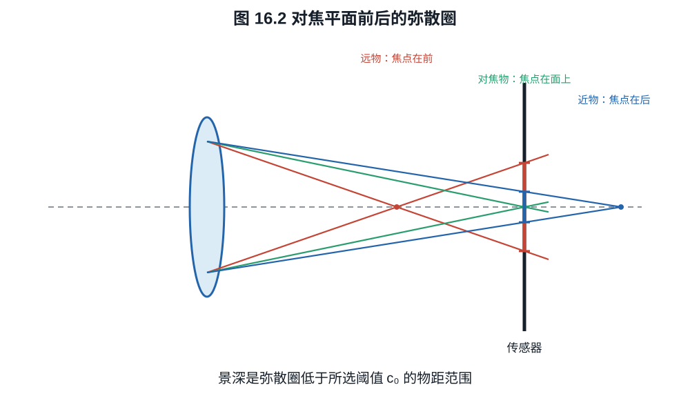
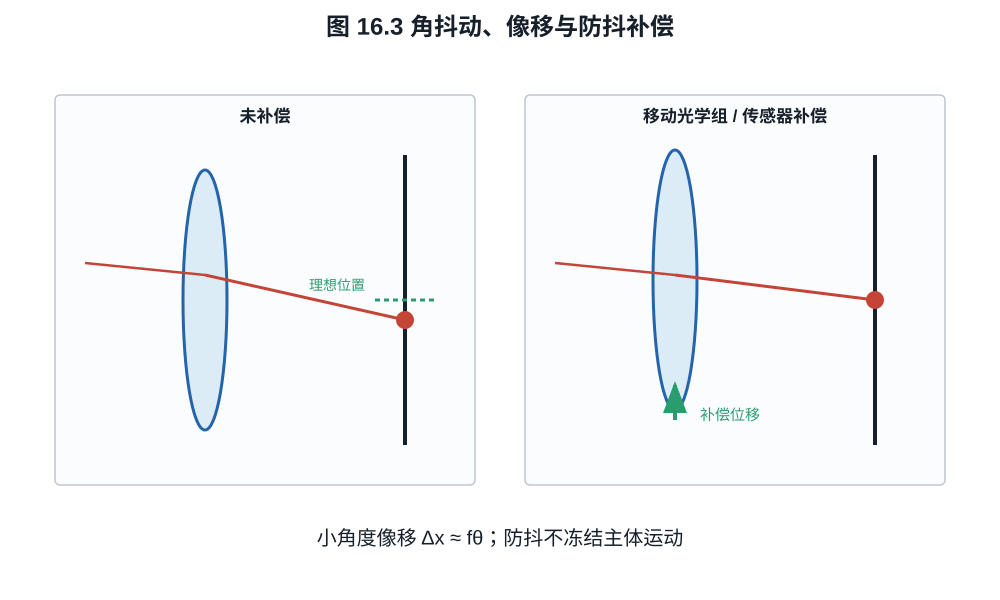

# 第十六章：镜头结构、对焦、变焦、防抖与远心性

转动变焦环时，镜头内部常有几个组同时移动：一部分改变总焦距，另一部分把清晰
像面维持在传感器附近。对焦和防抖也通过组运动改变光路，因此同一支镜头在不同
距离、焦段与光圈下会有不同表现。前几章分别讨论了材料和像差，现在把它们放回
可移动的镜组中，计算这些运动如何改变焦距、景深和像面位移。

## 16.1 几种典型光焦度分配

摄影镜头结构没有唯一分类，但一些一阶目的可识别：

- **双高斯型**：光阑附近近似对称，适合中等视角大光圈，能抵消部分奇次离轴像差；
- **反望远型（retrofocus）**：前负后正，使后焦距大于有效焦距，为广角与反光镜/卡口
  留空间；
- **望远型（telephoto）**：前正后负，使物理长度小于有效焦距；
- **远摄变焦**：多个正负组同时改变总光焦度并维持像面位置；
- **对称广角**：在无反光镜系统中可减小畸变，但可能给传感器边缘带来大主光线角。

这些名称描述光焦度布局，不直接给出画质等级。现代镜头常混合多种结构，并通过
非球面和数字畸变校正改变传统边界。

*图 16.1　正负号表示镜组的一阶光焦度，不是可制造处方。反望远结构换取较长后焦，
望远结构换取较短物理长度；像差、光阑和主平面仍由完整组间关系决定。*

## 16.2 对焦、浮动组与 breathing

整组伸长对焦遵循式 (11.5)，结构简单但长焦或微距所需移动量大。内对焦只移动较小
镜组，速度快、前端不转动，却会改变总系统矩阵，因而有效焦距、像差和入瞳位置随
距离变化。

浮动镜组让两个或更多组按不同规律移动，以补偿近距离球差、场曲和像散。镜头近摄
MTF 不能由无穷远 MTF 图推出；厂商图若只标 infinity，必须另测目标工作距离。

对焦呼吸（focus breathing）是对焦时视角/放大率变化。若机位和被观察物体不动，
物体到机身的位置固定，但从移动的主平面量起的物距仍可能变化。像高比例取决于
有效焦距、主平面与像面位置；内对焦改变这些量，就可能出现明显 breathing。
电影镜头常通过组间补偿降低它，但不能从“内对焦”名称判断大小。

**例子 16.1（固定焦距下的对焦尺度变化）.** 取焦距固定为 50 mm 的薄透镜，光阑
在透镜平面，传感器宽 36 mm。无穷远合焦时像距为 50 mm；对焦到物距 2 m 时，
由第十一章算得像距为 51.282 mm。连接像面边界与透镜中心的光线给出角覆盖

$$
2\arctan\frac{36}{2\times50}\approx39.60^\circ,\qquad
2\arctan\frac{36}{2\times51.282}\approx38.68^\circ.
$$

同一远处方向的主光线像高按像距变化，比例约为 $51.282/50=1.0256$；近对焦时
远景虽然离焦，其点像中心的角尺度仍会改变。这个薄透镜模型通过改变镜头与像面的
间距对焦，说明呼吸也可发生在有效焦距不变时。真实内对焦系统还会改变焦距、瞳和
主平面，应测量实际画面，而非仅把新焦距代入无穷远视角公式。

## 16.3 变焦为何需要补偿组

两薄透镜光焦度 $\Phi_1,\Phi_2$ 相距 $d$，空气中的合成光焦度为

$$
\Phi=\Phi_1+\Phi_2-d\Phi_1\Phi_2.                        \tag{16.1}
$$

将两片透镜矩阵与中间传播矩阵相乘，得到

$$
M=L_2T(d)L_1=
\begin{pmatrix}
1-d\Phi_1&d\\
-(\Phi_1+\Phi_2-d\Phi_1\Phi_2)&1-d\Phi_2
\end{pmatrix}.                                           \tag{16.1a}
$$

由 $-C$ 得到式 (16.1)，而平行入射的后焦距为
$\mathrm{BFD}=(1-d\Phi_1)/\Phi$。例如前组焦距 $+100$ mm、后组 $-100$ mm、
间隔 50 mm 时，总焦距为 200 mm，后焦距为 100 mm，两组到像面的总轴向距离为
150 mm。这给出望远结构短于有效焦距的一个近轴例子。若间隔改为 40 mm，总焦距
变成 250 mm，后焦距也变成 150 mm，原来的传感器位置便不再合焦。

变焦镜头用 variator 主要改变焦距，
compensator 同时移动以保持像面固定；现代多组设计由凸轮或电子控制多个轨迹。整个
变焦范围还需平衡像差、光圈、最近对焦和机械长度，因而一支恒定 $f/2.8$ 变焦比同
规格定焦复杂得多。

“恒定光圈”表示标称 f 数在变焦中保持，要求入瞳直径大致随焦距增加。若长端实际
透射下降，T-stop 仍可能变化。视频曝光稳定应看 T-stop 与控制步进，不只看 f 数。

## 16.4 景深是允许模糊标准

取空气中正薄透镜，$f>0,N>0$，物距 $s_0>f$ 从透镜平面量起，传感器位于
$v_0=fs_0/(s_0-f)$。另一物距 $s$ 的理想像距
$v=fs/(s-f)$。直径 $D=f/N$ 的光锥在传感器面的弥散圈直径近似

$$
c(s)=D\left|1-\frac{v_0}{v}\right|.                       \tag{16.2}
$$

*图 16.2　景深边界来自选定的容许弥散圈，不是光学上突然从清晰变模糊的界面。
对固定的正透镜，较远物体的焦点更靠近透镜，较近物体的焦点更远；有色竖线标出
同一传感器面处的光锥直径。圆锥图不包含像差、衍射和口径蚀。*

**推导 16.2.** 光锥从透镜口径直径 $D$ 线性收缩，在 $z=v$ 处为零。距透镜 $v_0$
处的截面直径按相似三角形为
$D|v-v_0|/v$，即式 (16.2)。

给定容许弥散圈直径 $c_0>0$，令无穷远物体的光锥在传感器上恰好满足
$c(\infty)=c_0$。将 $v=f$ 与 $v_0=fs_0/(s_0-f)$ 代入式 (16.2)，得
$c(\infty)=f^2/[N(s_0-f)]$，因此超焦距为

$$
H=\frac{f^2}{Nc_0}+f.                                    \tag{16.3}
$$

再把一般物距 $s>f$ 的像距代入式 (16.2)，得到

$$
c(s)=\frac{f^2|s-s_0|}{Ns(s_0-f)}.                       \tag{16.2a}
$$

近界满足 $s<s_0$，将 $c(s)=c_0$ 解为
$s=s_0/[1+Nc_0(s_0-f)/f^2]$；远界把加号改为减号。利用 $H-f=f^2/(Nc_0)$，得

$$
s_N=\frac{(H-f)s_0}{H+s_0-2f},
\qquad
s_F=\frac{(H-f)s_0}{H-s_0}.                              \tag{16.4}
$$

远界公式用于 $s_0<H$；当 $s_0\ge H$，无穷远已在允许模糊范围内，远界记为无穷远。
近界公式还要求求出的物距大于 $f$；若容许模糊取到使模型越出实物实像区，应直接
回到该区间内的式 (16.2a) 判断。通常摄影用的 $c_0\ll f/N$ 满足此条件。

有些速算式先忽略超焦距中的 $+f$，再把 $f^2/(Nc_0)$ 也写成 $H$。若使用这种
约定，应全程使用同一个近似；不能把它与式 (16.3) 的 $H$ 混用。一个直接检查是令
$s_0=H$：远界应为无穷远，近界恰为 $H/2$。

**例子 16.3（景深判据的数值后果）.** 取 $f=35$ mm、$N=4$、
$c_0=0.020$ mm，得

$$
H=\frac{35^2}{4\times0.020}+35
=15\,347.5\ \mathrm{mm}.
$$

对焦 $s_0=5$ m 时，式 (16.4) 给出
$s_N\approx3.78$ m、$s_F\approx7.40$ m。若把输出标准收紧为
$c_0=0.010$ mm，超焦距近似翻倍，景深范围也明显缩窄；镜头和对焦距离未变，变化
来自“可接受”的判据。

弥散圈不是传感器固有常数。它取决于输出尺寸、观看距离、视力、去马赛克和锐化；
高分辨率像素级审查需用更严格 $c_0$。景深范围内只是“低于选定模糊阈值”，不是每个
距离都与对焦平面同样清晰。

## 16.5 光学防抖与机身防抖

相机小角度旋转 $\theta$ 使无穷远像点移动

$$
\Delta x\approx f\theta.                                 \tag{16.5}
$$

*图 16.3　镜头防抖改变光束方向，机身防抖移动传感器；两者都试图减小曝光期间的
相对像移。图不表示控制回路带宽或可补偿的全部自由度。*

**例子 16.4（角抖动换算为像素位移）.** $f=100$ mm 时发生
$0.02^\circ=3.49\times10^{-4}$ rad 的小角转动，瞬时像移约

$$
\Delta x=100\times3.49\times10^{-4}
=0.0349\ \mathrm{mm}=34.9\ \mu\mathrm m.
$$

对 $4\ \mu\mathrm m$ 像素，这相当于 8.7 pixel。若要求瞬时位移不超过一像素，
残余角误差需低于 $p/f=4.0\times10^{-5}$ rad，即约 $0.00229^\circ$。实际模糊取决
于整段曝光中的角运动轨迹，不只取峰值。

焦距越长，同一角抖动造成的像面位移越大。镜头防抖移动补偿组改变出射光线角度；
机身防抖移动/旋转传感器追随像。两者可协同分配频率和轴向。

以曝光轨迹表达会更清楚：假设静止场景仅受平移像移 $\boldsymbol x(t)$，归一化
运动 OTF 为

$$
H_\mathrm{motion}(\boldsymbol\nu)
=\frac1{T_e}\int_0^{T_e}
e^{-2\pi i\boldsymbol\nu\cdot\boldsymbol x(t)}\,dt.        \tag{16.6}
$$

它来自把沿轨迹平移的点像按时间平均后取 Fourier 变换。若一维匀速移动，总位移
为 $b$，积分得到幅值 $|\sin(\pi\nu b)/(\pi\nu b)|$。始终保持同一个偏移只改变
位置，相位变了而 MTF 不变；曝光中来回移动才会形成模糊。因此防抖需控制曝光期间
的残余轨迹，不能仅用某一时刻的位移判断。

防抖不能冻结主体运动，也不能完全补偿平移视差、滚动快门和快门冲击。近摄中相机
平移与角抖动都重要，式 (16.5) 的无穷远模型不足。防抖宣称“若干档”是指定成功率
和测试条件下可用快门的统计改善，不是每张照片的保证。

## 16.6 远心性、主光线角与传感器

像方远心系统的出瞳位于无穷远，主光线近似垂直入射像面，放大率对像面小位移不敏感。
摄影镜头通常不完全远心，但数字传感器希望边缘主光线角不过大：滤色片、微透镜和硅
对斜入射的响应会下降或串扰。短后焦无反系统给广角设计更多自由，也可能要求偏置
微透镜和传感器专用校正。

卡口直径和法兰距只是约束集合的一部分。大卡口、短法兰可允许更大后组或更直的边缘
光线，但不能单独保证更大光圈或更高 MTF；前玉、入瞳、机械遮挡和镜头设计仍决定
实际能力。

## 16.7 怎样读一张镜头剖面图

按以下次序比数特殊镜片更有信息：

1. 找光阑并估计入瞳由前组怎样成像；
2. 标出主要正、负光焦度组，判断 retrofocus、telephoto 或近对称布局；
3. 查哪些组用于变焦、对焦和防抖；
4. 看后组尺寸和边缘主光线角，而不是只看卡口；
5. 再看非球面、低色散和衍射元件被放在哪个高光线高度位置；
6. 用 MTF、畸变、暗角、呼吸和近摄数据验证猜测。

剖面图能帮助提出机制假设，不能替代处方数据和实测。只数“18 片比 12 片高级”忽略
了每片曲率、材料、位置和装调误差。

## 练习

**练习 16.1.** 两薄透镜焦距分别 $100$ mm 和 $-200$ mm，相距 20 mm。用式
(16.1) 求合成光焦度与等效焦距。

**练习 16.2.** 50 mm $f/8$ 镜头，容许弥散圈 0.03 mm，计算超焦距。对焦 10 m
时求近、远界。

**练习 16.3.** 200 mm 镜头发生 $0.01^\circ$ 角抖动，按式 (16.5) 计算像面位移，
并换算成 $4\ \mu$m 像素数。
